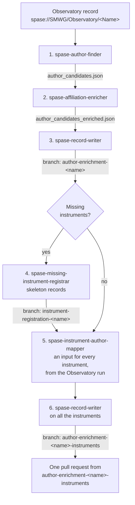

# SPASE Metadata Agents

[Claude Code](https://docs.claude.com/en/docs/claude-code/overview) agents that fill in missing authorship metadata in [SPASE](https://spase-group.org/) records. They find the people who belong on a record, look up their ORCID, affiliation and ROR, write them into the record as Contacts and Person records, and register any instruments missing from SPASE. Every value cites its source, and the results go on a branch for you to review.

## The agents

| Agent | What it does | Output |
|---|---|---|
| `spase-author-finder` | Finds candidate authors for a record, with evidence for each | `author_candidates.json` |
| `spase-affiliation-enricher` | Adds ORCID, affiliation and ROR for each candidate | `author_candidates_enriched.json` |
| `spase-record-writer` | Writes Contacts and Person records into your SPASE clone | a branch |
| `spase-missing-instrument-registrar` | Creates skeleton records for an Observatory's missing instruments | a branch |
| `spase-instrument-author-mapper` | Builds the writer's input for every instrument of the Observatory, reusing the authors the Observatory run found | one input per instrument |

Each agent's full procedure is in `.claude/skills/<agent>/SKILL.md`.

## Before you start

- Claude Code, run from the root of this repository
- Python 3 and `curl`
- A local clone of your fork of the target SPASE repository, e.g. [hpde/SMWG](https://github.com/hpde/SMWG), up to date and clean

## Running one mission



Ask Claude Code to run each agent in turn. Review each output before the next step.

```text
1. Use the spase-author-finder agent on spase://SMWG/Observatory/<Name>
2. Use the spase-affiliation-enricher agent on spase_records/<Name>/author_candidates.json
3. Use the spase-record-writer agent on spase_records/<Name>/author_candidates_enriched.json with my clone at ~/SMWG
4. Use the spase-missing-instrument-registrar agent on spase_records/<Name>/author_candidates_enriched.json with my clone at ~/SMWG
5. Use the spase-instrument-author-mapper agent on spase_records/<Name>/author_candidates_enriched.json with my clone at ~/SMWG
6. Use the spase-record-writer agent on the instrument inputs, with the command step 5 prints
```

- Save the finder's output in `spase_records/<Name>/`, named after the Observatory (`Juno` for `spase://SMWG/Observatory/Juno`). The later steps find each other's branches by that name.
- Commit and push the JSON files before step 3; the writer links to them by commit.
- Step 4 is only needed when step 1 reports missing instruments.
- Step 5 tells you if an instrument needs the enricher or the finder run on it before step 6. Instruments filed under another authority (NOAA, say) are listed in its report for that authority's curators, not written.

When it's done, open **one pull request**, from `author-enrichment-<name>-instruments`. Each branch builds on the one before, so the last one holds everything. If you re-run a step, re-run every step after it.

## Running the scripts directly

```bash
# write records from an enriched file
python3 .claude/skills/spase-record-writer/scripts/run_pipeline.py \
    --repo ~/SMWG --input spase_records/<Name>/author_candidates_enriched.json --initials <you>

# see which Instrument records already exist for an Observatory, under any authority
python3 .claude/skills/spase-missing-instrument-registrar/scripts/registry.py \
    lookup --observatory spase://SMWG/Observatory/<Name>

# check records locally
python3 .claude/skills/spase-record-writer/scripts/spase-localcheck.py \
    --repo-root ~/SMWG Observatory/<Name>.xml Person/
```

Add `--dry-run` (registrar, author mapper) or `--no-push` (writer) to try a run without changing anything remote.

### When the writer agent asks about a person

Before writing, the writer agent checks each person against the existing SPASE Person records. When a candidate might be someone who already has a record ("B. K. Dichter" from a paper, and an existing `Bronislaw.K.Dichter`), it stops without changing anything and writes `writer_decisions.json` next to its input, listing the possible matches. It doesn't guess, because linking to the wrong record credits the wrong person, and a second record for the same person splits their identity.

When it happens, the run halts and waits for you. When you run the writer as an agent, it explains the possible matches itself and asks you.

Rule on each name, then run the writer agent again:

- `links`: same person as an existing record, so use that record
- `creates`: a different person, so make a new record

```json
{ "links": { "B. K. Dichter": "Bronislaw.K.Dichter" }, "creates": ["Pamela C. Sullivan"] }
```

You rule on each person once per mission: the author mapper copies these rulings to the mission's instrument inputs.

## Review and undo

The agents never change the official SPASE repository. They put their changes on a branch in your own fork and stop there, so you can review them and decide whether to open a pull request.

To throw a branch away, delete it on GitHub and on your computer:

```bash
git push -d origin <branch>
git branch -D <branch>
```

A mission can have up to three branches; delete all of them to discard the whole mission.

## License

No license has been specified yet.
