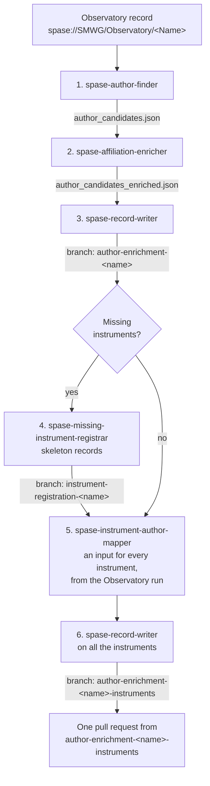

# SPASE Metadata Agents

[Claude Code](https://docs.claude.com/en/docs/claude-code/overview) agents that fill in missing authorship metadata in [SPASE](https://spase-group.org/) records. They find the people who belong on a record, look up their ORCID, affiliation and ROR, write them into the record as Contacts and Person records, and register any instruments missing from SPASE. Every value cites its source, and the results go on a branch for you to review.

## The agents

| Agent | What it does | Output |
|---|---|---|
| `spase-author-finder` | Finds candidate authors for a record, with evidence for each | `author_candidates.json` |
| `spase-affiliation-enricher` | Adds ORCID, affiliation and ROR for each candidate | `author_candidates_enriched.json` |
| `spase-record-writer` | Writes Contacts and Person records into your SPASE clone | a branch |
| `spase-missing-instrument-registrar` | Creates skeleton records for an Observatory's missing instruments | a branch |
| `spase-instrument-author-mapper` | Builds the writer's input for every instrument of the Observatory, reusing the authors the Observatory run found | one input per instrument |

Each agent's full procedure is in `.claude/skills/<agent>/SKILL.md`.

## Before you start

- Claude Code, run from the root of this repository
- Python 3 and `curl`
- A local clone of your fork of the target SPASE repository, e.g. [hpde/SMWG](https://github.com/hpde/SMWG), up to date and clean
- Optional: a free [OpenAlex](https://openalex.org) API key, from [openalex.org/settings/api](https://openalex.org/settings/api). The author finder searches OpenAlex for publications; without a key, the daily allowance is about 100 searches, enough for a mission or two. To use a key, add `export OPENALEX_API_KEY=<your key>` to `~/.zshrc` and open a new Terminal.

## Running one mission



Ask Claude Code to run each agent in turn. Review each output before the next step.

```text
1. Use the spase-author-finder agent on spase://SMWG/Observatory/<Name>
2. Use the spase-affiliation-enricher agent on spase_records/<Name>/author_candidates.json
3. Use the spase-record-writer agent on spase_records/<Name>/author_candidates_enriched.json with my clone at ~/SMWG
4. Use the spase-missing-instrument-registrar agent on spase_records/<Name>/author_candidates_enriched.json with my clone at ~/SMWG
5. Use the spase-instrument-author-mapper agent on spase_records/<Name>/author_candidates_enriched.json with my clone at ~/SMWG
6. Use the spase-record-writer agent on the instrument inputs, with the command step 5 prints
```

- Save the finder's output in `spase_records/<Name>/`, named after the Observatory (`Juno` for `spase://SMWG/Observatory/Juno`). The later steps find each other's branches by that name.
- Commit and push the JSON files before step 3; the writer links to them by commit.
- Step 4 is only needed when step 1 reports missing instruments.
- Step 5 tells you if an instrument needs the enricher or the finder run on it before step 6. Instruments filed under another authority (NOAA, say) are listed in its report for that authority's curators, not written.

When it's done, open **one pull request**, from `author-enrichment-<name>-instruments`. Each branch builds on the one before, so the last one holds everything. If you re-run a step, re-run every step after it.

### Running a whole mission in one go

To run all six steps without checking in between, give Claude Code this single prompt. Fill in the first four lines for each mission.

```text
SPASE Observatory ID: spase://SMWG/Observatory/<Name>
Record name: <Name>        (the folder under spase_records/; GOES_16 for GOES/16)
SMWG clone: ~/SMWG
My initials: <your initials>

Run the whole pipeline for this Observatory without stopping between steps.
Record the time (date) at the start and at the end of each step.

0. Check that the SMWG clone is on master, up to date with origin, with no
   local changes. If not, stop and tell me.
1. Use the spase-author-finder agent on the SPASE Observatory ID. Save its
   output in spase_records/<Record name>/.
2. Use the spase-affiliation-enricher agent on
   spase_records/<Record name>/author_candidates.json.
   Then commit and push the spase_records/<Record name>/ files in this repo.
3. Use the spase-record-writer agent on
   spase_records/<Record name>/author_candidates_enriched.json with the SMWG clone.
   Then commit and push writer_decisions.json if one was written.
4. Only if step 1 reported missing instruments: use the
   spase-missing-instrument-registrar agent on the same enriched file with the
   SMWG clone. Then commit and push its plan.
5. Use the spase-instrument-author-mapper agent on the same enriched file with
   the SMWG clone. For each ENRICH instrument, run the enricher on its input;
   for each FULL RUN, run the finder and then the enricher. Then commit and push
   all the new spase_records/<Record name>_*/ files.
6. Use the spase-record-writer agent on every ready instrument input, with the
   command step 5 prints. Then commit and push any new writer_decisions.json.

Stop and ask me only if: the clone isn't clean, an agent says it needs a human
decision it cannot make itself, a writer run fails for a reason other than a
duplicate-person ruling, or validation reports new errors. Never open a pull
request.

At the end, give me:
- what each step produced, and the branch to open the pull request from
- what I should review first: the finder's paper choice and which literature
  sources agreed, any low-confidence duplicate rulings, registrar flags, and
  report-only instruments
- runtime of each step and in total, and the tokens each agent used where
  Claude Code reports them
- a reminder to type /usage for the session's total tokens and cost
```

- Your review moves to the end, so start with the items the summary lists before you open the pull request.
- Claude Code may still ask before running commands such as `git push`. Choose the option that stops it asking again for that command, and the rest of the run goes through.
- Claude can't see the session's token count or cost. Type `/usage` when the run finishes. On a Pro or Max plan, the dollar figure there is the list-price equivalent, not what you're billed.

## Running the scripts directly

```bash
# write records from an enriched file
python3 .claude/skills/spase-record-writer/scripts/run_pipeline.py \
    --repo ~/SMWG --input spase_records/<Name>/author_candidates_enriched.json --initials <you>

# see which Instrument records already exist for an Observatory, under any authority
python3 .claude/skills/spase-missing-instrument-registrar/scripts/registry.py \
    lookup --observatory spase://SMWG/Observatory/<Name>

# check records locally
python3 .claude/skills/spase-record-writer/scripts/spase-localcheck.py \
    --repo-root ~/SMWG Observatory/<Name>.xml Person/
```

Add `--dry-run` (registrar, author mapper) or `--no-push` (writer) to try a run without changing anything remote.

### When a person may already have a record

Before writing, the writer agent checks each person against the existing SPASE Person records. When a candidate might be someone who already has a record ("B. K. Dichter" from a paper, and an existing `Bronislaw.K.Dichter`), it doesn't stop to ask you. It weighs the evidence (ORCID, initials, affiliation, email, field and era), decides, and goes ahead. When the evidence is evenly balanced, it treats them as different people, because linking to the wrong record credits the wrong person, while a duplicate record can be merged later.

Each ruling is written to `writer_decisions.json` next to its input, with the reason and a confidence of `high` or `low`:

- `links`: same person as an existing record, so it uses that record
- `creates`: a different person, so it makes a new record

```json
{
  "links": { "B. K. Dichter": "Bronislaw.K.Dichter" },
  "creates": ["David C. Slater"],
  "_rationale": { "David C. Slater": "DIFFERENT PEOPLE (agent decision, 2026-11-11) - ..." },
  "_confidence": { "B. K. Dichter": "high", "David C. Slater": "high" }
}
```

The writer agent lists its rulings in its report, the `low` ones first, so check those before you open the pull request. To change a ruling, edit the file and run the writer agent again. Each person is ruled on once per mission: the author mapper copies the rulings to the mission's instrument inputs. Commit `writer_decisions.json` with the mission's other JSON files.

## Review and undo

The agents never change the official SPASE repository. They put their changes on a branch in your own fork and stop there, so you can review them and decide whether to open a pull request.

To throw a branch away, delete it on GitHub and on your computer:

```bash
git push -d origin <branch>
git branch -D <branch>
```

A mission can have up to three branches; delete all of them to discard the whole mission.

## License

Licensed under the [Apache License 2.0](LICENSE).
